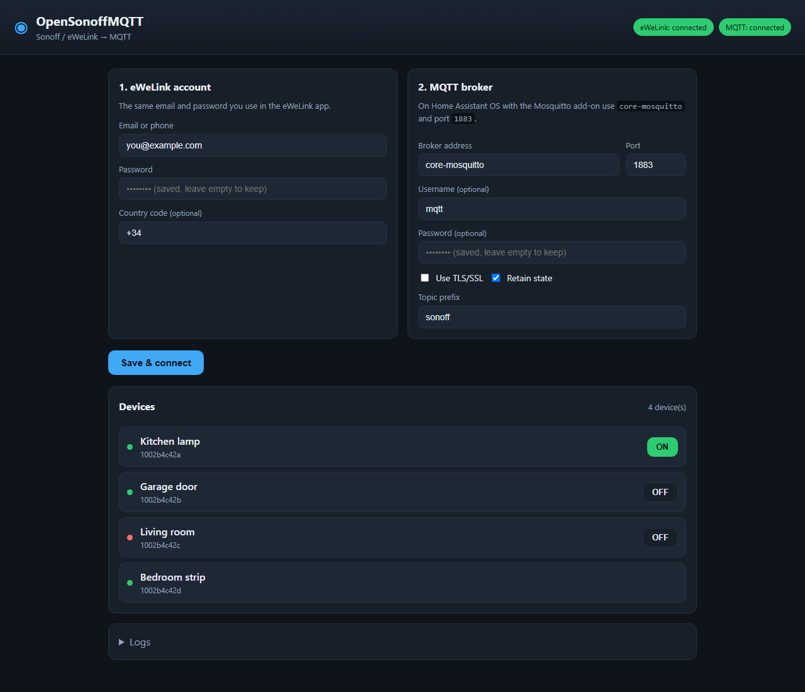

# OpenSonoffMQTT (Home Assistant add-on)

Control your Sonoff / eWeLink devices and publish them over MQTT — the same
topic contract as the [OpenSonoffMQTT Home Assistant integration](../README.md),
but running as a stand-alone app.



---

## Install as a Home Assistant add-on

[](https://my.home-assistant.io/redirect/supervisor_add_addon_repository/?repository_url=https%3A%2F%2Fgithub.com%2FAssidefok%2FOpenSonoffMQTT)

Or add the repository manually:

1. In Home Assistant go to **Settings > Add-ons > Add-on store**.
2. Click the **three dots** in the top-right corner and choose **Repositories**.
3. Paste the repository URL and click **Add**:

   ```
   https://github.com/Assidefok/OpenSonoffMQTT
   ```

4. Close the dialog. Find **OpenSonoffMQTT** in the store and click **Install**.
5. Click **Start**.
6. Click **Open Web UI** — the app opens in the Home Assistant sidebar
   (it uses ingress, so there is no extra port to open).

## First run

The configuration page asks for two things:

- **eWeLink account** — the email and password you use in the eWeLink app.
- **MQTT broker** — where the devices should be published:
  - On Home Assistant OS with the **Mosquitto broker** add-on, the host is
    `core-mosquitto`, port `1883`.
  - Enter the broker **username and password** if your broker requires them
    (on HAOS this is usually a Home Assistant user you created for MQTT).

Click **Save & connect**. The app logs in to eWeLink, loads your devices and
starts publishing them to MQTT.

## Web UI

The app is the control panel for the bridge, split into four tabs:

- **Devices** — every device with its online state, switch control and live
  power / voltage / current, plus a status line with the MQTT connection, the
  topic prefix and the Home Assistant discovery state.
- **Configuration** — the eWeLink account, the MQTT broker and the discovery
  options.
- **MQTT** — every message the app publishes (topic and payload, last 200),
  refreshed every 2 seconds, so you can see exactly what Home Assistant
  receives.
- **Logs** — the last 200 lines of the app, refreshed every 3 seconds (MQTT
  connection, eWeLink login, discovery and errors), so you can diagnose the
  bridge without leaving the app.

## Home Assistant discovery

Discovery is **on by default**: the app publishes retained
`homeassistant/switch/<unique_id>/config` and
`homeassistant/sensor/<unique_id>/config` payloads, so every device appears
automatically under **Settings > Devices & services > MQTT** — no YAML and no
custom integration needed.

- Each Sonoff device becomes one Home Assistant device
  (`opensonoffmqtt_<deviceid>`) with one switch per channel and sensors for
  power, voltage, current, temperature and humidity when the device reports
  them.
- Entities follow the per-device availability topic, and stopping the app marks
  them offline.
- Uncheck **Publish Home Assistant discovery** (and/or change the discovery
  prefix) in the configuration form if you use the custom integration and don't
  want duplicate entities.

## MQTT topics

With the default prefix `sonoff`, the app publishes/subscribes:

| Topic | Direction | Meaning |
| --- | --- | --- |
| `sonoff/<deviceid>/state` | app → broker | JSON device snapshot (retained) |
| `sonoff/<deviceid>/availability` | app → broker | `online` / `offline` (retained) |
| `sonoff/<deviceid>/get` | broker → app | republish the current snapshot |
| `sonoff/<deviceid>/set` | broker → app | JSON params, or `ON` / `OFF` / `TOGGLE` |
| `sonoff/bridge/status` | app → broker | `online` / `offline` (retained) |
| `sonoff/bridge/devices` | app → broker | device list, JSON (retained) |
| `homeassistant/<component>/<unique_id>/config` | app → broker | Home Assistant discovery (retained) |

## Stand-alone Docker

Prefer running it without Home Assistant? A `docker-compose.yml` is included at
the repository root. It builds the same image from `addon/`, keeps the config in
`./data` and exposes port `8099`:

```sh
docker compose up -d
```

Then open <http://localhost:8099>.

Change the `log_level` add-on option only on Home Assistant; when running with
Docker you can set `LOG_LEVEL` (for example `LOG_LEVEL=debug`) in the compose
`environment` section, or pass `--log-level` to uvicorn yourself.

## How it talks to your devices

- It logs into the eWeLink cloud with your account and loads the device list.
- If a device is reachable on the local network (mDNS `_ewelink._tcp.local`),
  commands go over the LAN first and fall back to the cloud; state updates
  arrive from both.
- DIY devices that only exist on the LAN are added automatically.

## Security

When installed as a Home Assistant add-on, the web page is protected by Home
Assistant's login (ingress). If you run it with Docker and expose port `8099`
to your network, put it behind a reverse proxy with authentication or only
expose it on a trusted LAN: anyone who can open the page can control your
devices and change the configuration.


